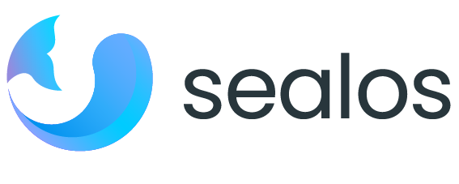
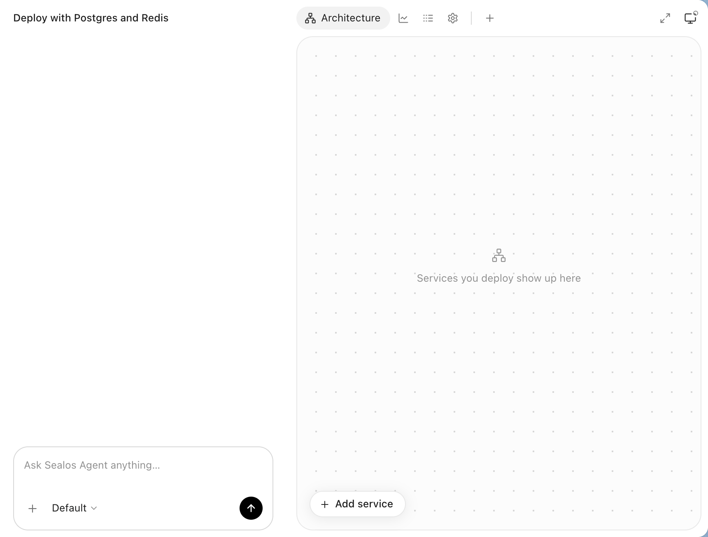
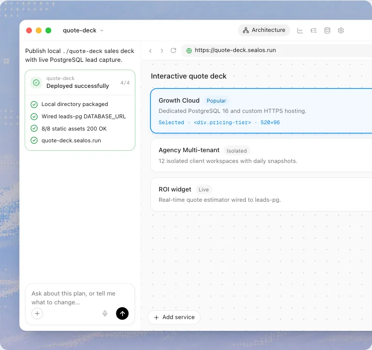
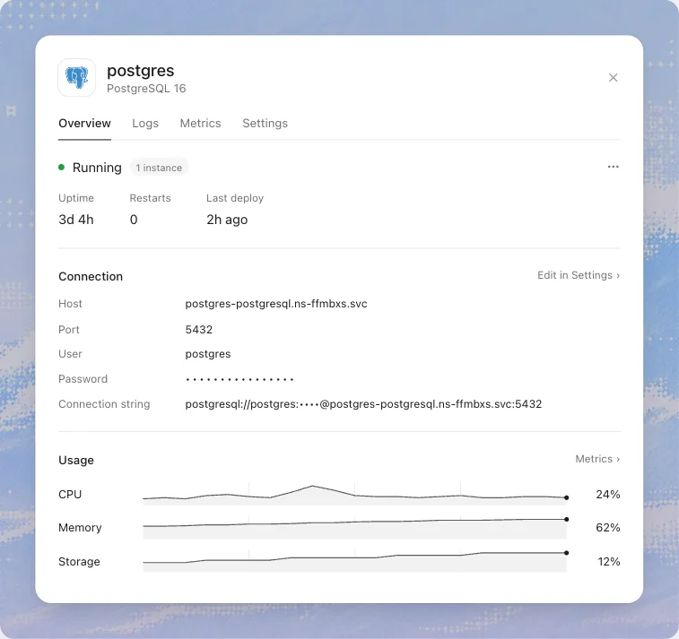
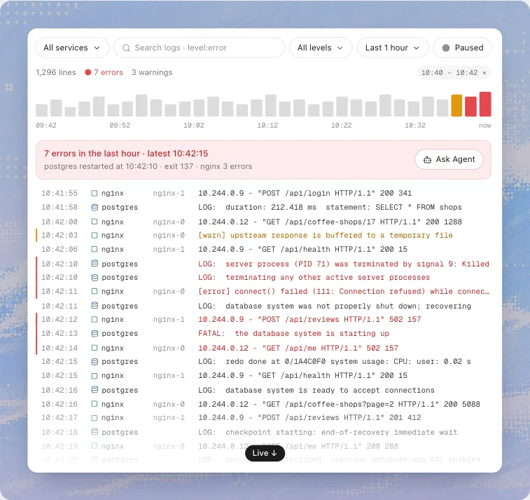

  <a href="https://sealos.io/">
    <picture>
      <source media="(prefers-color-scheme: dark)" srcset="./docs/img/sealos-left-dark.png" />
      <source media="(prefers-color-scheme: light)" srcset="./docs/img/sealos-left.png" />
      
    </picture>
  </a>

<h1 align="center">Your code is ready. Let Sealos ship it.</h1>

A desktop Ops Agent for deploying and running full-stack apps. Local code, cloud infrastructure, and ongoing operations — in one project.

  

  <a href="https://github.com/sealox/sealox-releases/releases/latest">macOS &amp; Windows</a> ·
  <a href="https://sealos.cn/downloads">Download in China</a> ·
  <a href="https://sealos.io/docs">Documentation</a> ·
  <a href="./README_zh.md">简体中文</a>

  

Deployment walkthrough from the Sealos homepage. Click to explore the interactive demo.

## Meet Sealos Desktop

Turn a local folder, a GitHub repository, a container image, or an application template into a running service. Describe what the project needs; the built-in agent handles the deployment workflow and connects the supporting resources.

The desktop app connects your local development workflow to Sealos Cloud. Your services run in the cloud region you choose, and stay available when you close the desktop app.

### From local code to a public URL

Bring the project you already have, including code written with AI tools. Sealos analyzes the application, builds its image, provisions dependencies and deploys it with a public HTTPS endpoint. Databases and application configuration stay alongside the service they support.

  

### Keep the whole project in view

See how your app and its dependencies fit together. Inspect deployments, connection details, resource usage and service health from the project view; open logs or a container terminal when you need to investigate.

  

### Ask your Ops Agent when something breaks

Investigate failed deployments, restarts, 502 errors and memory limits with the context of the whole project. The agent uses logs and metrics to explain the issue and propose a fix. Review change plans before execution, check the result and roll back a deployment when needed.

  

## Everything the app depends on

| Resource | What Sealos brings together |
| --- | --- |
| **App hosting** | Deploy local projects, GitHub repositories, container images and ready-to-run templates. |
| **Databases & cache** | PostgreSQL, MySQL, MongoDB and Redis, with application connection configuration and daily backups. |
| **Object storage** | S3-compatible buckets for uploads, assets and shared files. |
| **AI Gateway** | Model access through a unified endpoint and API key, managed from your workspace. |
| **Operations** | Logs, metrics, deployment history, rollback, scaling and agent-assisted troubleshooting. |
| **Team workspaces** | Shared projects and resources, with individual member credentials. |

Kubernetes powers the platform underneath. Apps use standard container images and databases use familiar engines, so your deployment remains portable.

## Get started

1. **[Download Sealos Desktop](https://github.com/sealox/sealox-releases/releases/latest)** for macOS or Windows, install it and sign in.
2. **Bring a project.** Open a local folder, paste a GitHub URL, deploy a container image, or pick a template such as Dify, n8n, WordPress or Open WebUI.
3. **Describe the outcome.** For example: “Deploy this project with PostgreSQL and Redis.”
4. **Review and deploy.** Approve the plan, open your public URL, then use the same project to monitor and maintain the stack.

[Explore the live product demo](https://sealos.io/) · [Read the docs](https://sealos.io/docs)

## 🏘️ Community & support

- 🌐 Visit the [Sealos Website](https://sealos.io/) for full documentation and useful links.
- 💬 Join our [Discord Server](https://discord.gg/wdUn538zVP) to chat with the Sealos team and other Sealos users. This is a good place to learn about Sealos and Kubernetes, ask questions, and share your experiences.
- 🐦 Tweet at @Sealos_io on [X/Twitter](https://twitter.com/Sealos_io) and follow us.
- 🐞 Create [GitHub Issues](https://github.com/labring/sealos/issues/new/choose) for bug reports and feature requests.

## 🚧 Roadmap

Sealos maintains a [public roadmap](https://github.com/orgs/labring/projects/4/views/9). It gives a high-level view of the main priorities for the project, the maturity of different features and projects, and how to influence the project direction.

## 👩‍💻 Contributing & Development

Have a look through [existing issues](https://github.com/labring/sealos/issues?q=is%3Aissue+is%3Aopen+sort%3Aupdated-desc) and [Pull Requests](https://github.com/labring/sealos/pulls?q=is%3Apr+is%3Aopen+sort%3Aupdated-desc) that you could help with. If you'd like to request a feature or report a bug, please [create a GitHub Issue](https://github.com/labring/sealos/issues/new/choose) using one of the templates provided.

📖 [See contribution guide →](./CONTRIBUTING.md)

🔧 [See development guide →](./DEVELOPGUIDE.md)

## Links

- [FastGPT](https://github.com/labring/FastGPT) is a free, open-source, and powerful AI knowledge base platform, offers out-of-the-box data processing, model invocation, RAG retrieval, and visual AI workflows. Easily build complex LLM applications.
- [Buildah](https://github.com/containers/buildah) The functionalities of Buildah are extensively utilized in Sealos 4.0 to ensure that cluster images are compatible with OCI standard.

[deploy-badge]: https://sealos.io/Deploy-on-Sealos.svg
[deploy-link]: https://os.sealos.io

## 📄 License

Sealos is licensed under the [Sealos Sustainable Use License](./LICENSE.md), a custom license that allows:

- ✅ Internal business use and personal non-commercial use
- ❌ Providing cloud services to third parties

**Not a standard open source license** - please review the [full license terms](./LICENSE.md) before use.

**Contributing**: By contributing, you agree to our [Contributor License Agreement](./CONTRIBUTOR_LICENSE_AGREEMENT.md) and license change terms.

<!-- ## License -->

<!--  -->
