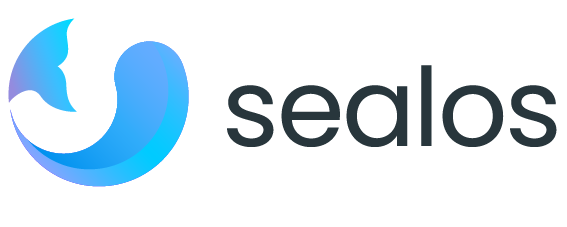
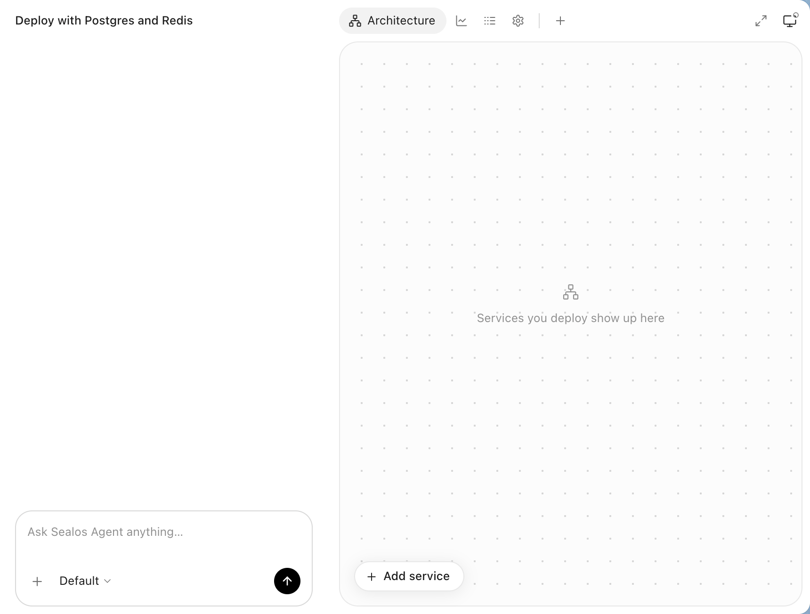
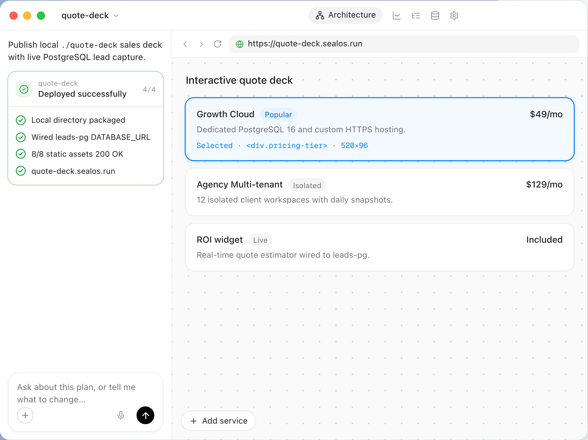
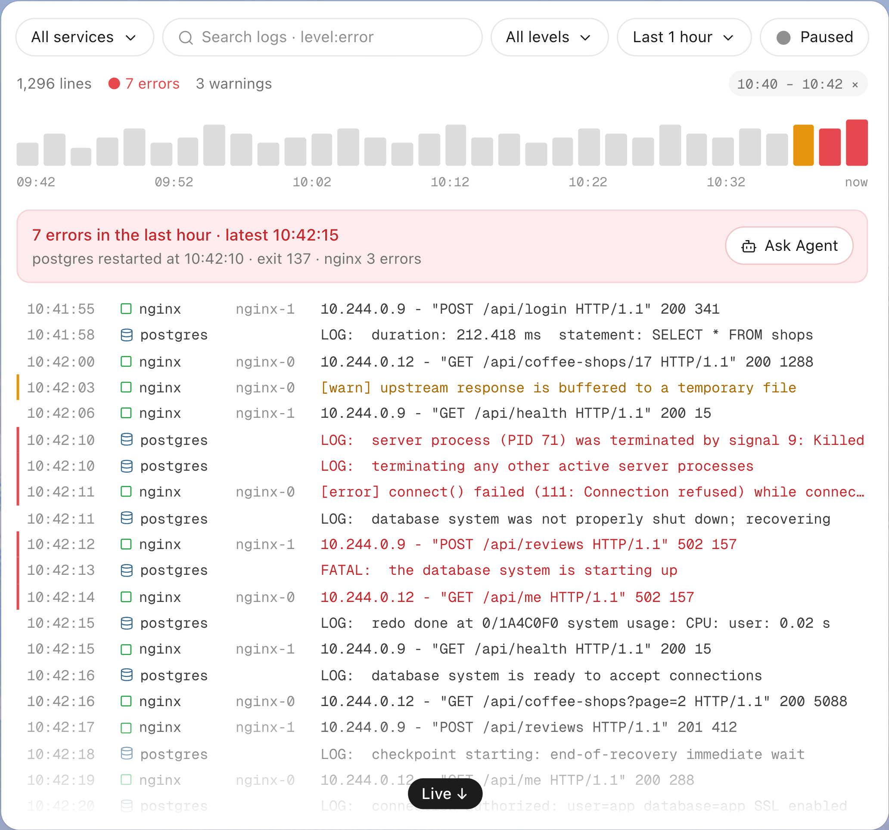
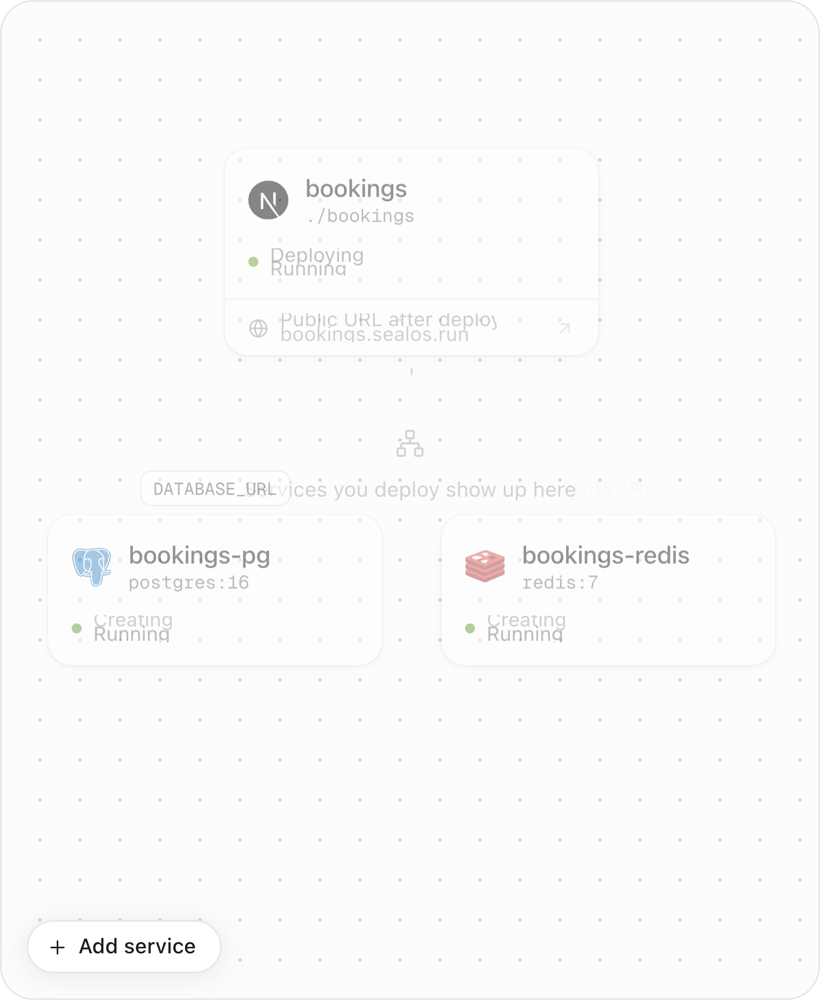

  <a href="https://sealos.io/">
    <picture>
      <source media="(prefers-color-scheme: dark)" srcset="./docs/img/sealos-left-dark.png" />
      <source media="(prefers-color-scheme: light)" srcset="./docs/img/sealos-left.png" />
      
    </picture>
  </a>

<h1 align="center">代码写好了，让 Sealos 帮你上线。</h1>

专注于应用上线与持续运维的桌面 Agent。 从本地代码到云端运行，把应用和依赖放在同一个项目里管理。

  

  <a href="https://sealos.cn/downloads">macOS / Windows 下载</a> ·
  <a href="https://github.com/sealox/sealox-releases/releases/latest">国际版下载</a> ·
  <a href="https://sealos.cn/docs">文档</a> ·
  <a href="./README.md">English</a>

  

国际版官网部署演示。点击图片查看原尺寸；<a href="https://sealos.io/">体验完整交互</a>。

## 认识 Sealos Desktop

用 AI 写完代码后，下一步是让项目真正运行起来。Sealos Desktop 内置面向部署与运维的 Agent：理解项目、构建镜像、创建依赖、发布服务，并协助你处理上线之后的问题。

本地目录、GitHub 仓库、容器镜像和应用模板，都可以作为起点。应用、数据库、缓存、对象存储和模型访问配置，在同一个项目中完成交付和管理。

### 为什么是桌面版？

- **承接本地开发。** 直接选择电脑上的源码目录，将本地开发或 AI 工具生成的项目交给 Agent 部署。
- **内置专用 Agent。** 用自然语言描述上线和运维需求，由 Agent 结合项目与云端资源执行工作流。
- **依赖一起交付。** 创建应用所需的数据库、缓存、存储和模型密钥，并配置应用与资源之间的连接。

桌面版是控制中心，线上服务运行在你选择的 Sealos Cloud 区域；关闭客户端后，服务仍在云端运行。

以下界面来自国际版官网演示，文字与图标均按高像素密度重新截取。

## 从源代码到线上服务

选择项目并描述目标，例如：“部署这个项目，使用 PostgreSQL 保存数据、Redis 管理会话。”Agent 分析项目，完成构建、依赖配置与云端部署，最终交付可访问的公网链接。

  

## 上线之后，继续交给 Agent 协助运维

构建失败、容器重启、异常日志、数据库连接故障，都可以在项目上下文中直接提问。Agent 分析原因并给出修复方案；需要确认的变更通过计划呈现，执行后继续检查结果。

下图展示了国际版的项目日志视图：数据库异常退出后，应用出现连接失败与 502 错误。结合日志、状态和指标，可以向 Agent 发起诊断。

  

## 用资源拓扑理解整个项目

应用、数据库和缓存之间的关系集中展示。查看服务状态和资源连接，进入部署记录、日志、监控与环境变量，排查问题时保留完整的项目上下文。

  

## 应用需要的基础设施，在一个工作空间里

| 能力 | 可以做什么 |
| --- | --- |
| **应用托管** | 部署本地项目、GitHub 仓库、容器镜像，或使用 Dify、n8n、WordPress、Open WebUI 等模板。 |
| **数据库与缓存** | 创建 PostgreSQL、MySQL、MongoDB、Redis，配置应用连接，并使用每日备份。 |
| **对象存储** | 使用兼容 S3 的存储桶管理上传文件、静态资源和共享文件。 |
| **AI 网关** | 通过统一端点和 API Key 接入模型服务，在工作空间中管理访问配置。 |
| **持续运维** | 查看日志与指标、诊断故障、调整资源、管理部署历史和回滚。 |
| **团队协作** | 在共享工作空间中管理项目与资源，每位成员使用自己的凭据。 |

Sealos 底层由 Kubernetes 驱动，应用采用标准容器镜像，数据库使用通用引擎，方便后续迁移与扩展。

## 开始使用

1. **[下载 Sealos Desktop](https://sealos.cn/downloads)**，选择 macOS 或 Windows 安装包，安装后登录。
2. **选择项目来源**：本地目录、GitHub 仓库、容器镜像或应用模板。
3. **描述上线需求**，查看 Agent 给出的执行计划并确认。
4. **打开线上链接**，在同一项目中继续查看状态、管理资源和排查问题。

[体验完整产品演示](https://sealos.cn/downloads) · [阅读文档](https://sealos.cn/docs)

## 🏘️ 社区与支持

- 🌐 访问 [Sealos官网](https://sealos.io/) 获取完整的文档和实用链接。

- 💬 加入我们的 [Discord服务器](https://discord.gg/qzBmGGZGk7)，与 Sealos 开发者和终端用户进行交流。这是了解 Sealos 和 Kubernetes 以及提问和分享经验的理想之地。

- 🐦 在 [Twitter](https://twitter.com/Sealos_io) 上关注我们。

- 🐞 请将任何 Sealos 的 Bug、问题和需求提交到 [GitHub Issue](https://github.com/labring/sealos/issues/new/choose)。

## 🚧 发展规划

Sealos 维护了一个[公开的发展路线图](https://github.com/orgs/labring/projects/4/views/9)，为项目的主要优先事项、不同功能和项目的成熟度，以及如何影响项目方向提供了高级视图。

## 👩‍💻 贡献与开发

翻阅[现有的 Issue](https://github.com/labring/sealos/issues?q=is%3Aissue+is%3Aopen+sort%3Aupdated-desc) 和 [Pull Requests](https://github.com/labring/sealos/pulls?q=is%3Apr+is%3Aopen+sort%3Aupdated-desc)，看看您是否能提供帮助。如果您想要新增需求或报告 Bug，请使用我们提供的模板[创建一个 GitHub Issue](https://github.com/labring/sealos/issues/new/choose)。

📖 [查看贡献指南 →](./CONTRIBUTING.md)

🔧 [查看开发指南 →](./DEVELOPGUIDE.md)

## 🔗 链接

- [Laf](https://github.com/labring/laf) 是 Sealos 上的一款函数计算应用，让写代码像写博客一样简单，随时随地发布上线。
- [Buildah](https://github.com/containers/buildah) 在 Sealos 4.0 中，我们广泛地利用了 Buildah 的能力，以确保集群镜像与 OCI 标准兼容。

## 📄 许可证

Sealos 采用 [Sealos 可持续使用许可证](./LICENSE.md)，这是一个定制许可证，允许：
- ✅ 内部商业用途和个人非商业用途
- ❌ 向第三方提供云服务

**这不是标准的开源许可证** - 使用前请查看 [完整许可证条款](./LICENSE.md)。

**贡献代码**: 通过贡献代码，您同意我们的 [贡献者许可协议](./CONTRIBUTOR_LICENSE_AGREEMENT.md) 和许可证变更条款。

<!-- ## License -->

<!--  -->
